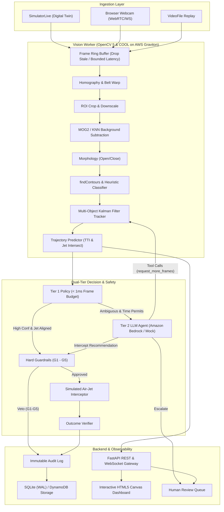
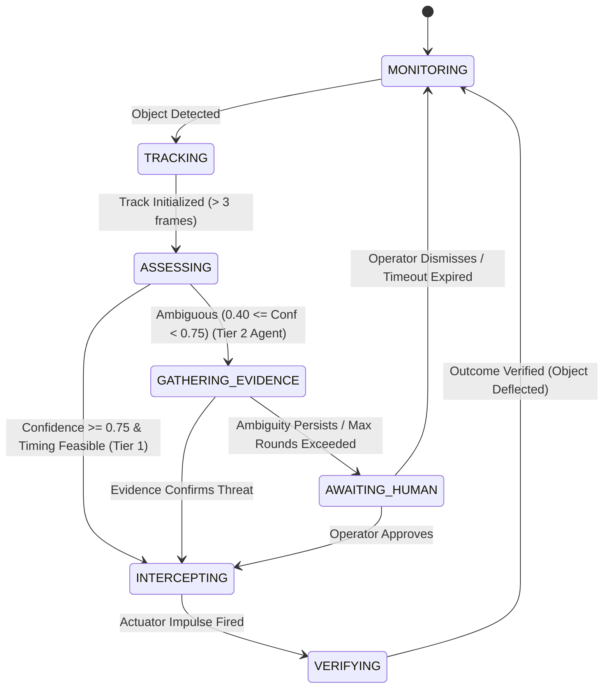

# ZoneShield AI Architecture & Technical Design

**Tagline:** *See the Threat. Predict the Path. Protect the Zone.*

ZoneShield AI is an active vision inspection and foreign-object interception system powered by **OpenCV 5** and **AWS (Graviton + Cloud-Optimized OpenCV Library / COOL)**. Rather than passively alerting after an anomaly has already contaminated production, ZoneShield AI operates a closed, live **Perception -> Prediction -> Decision -> Action -> Verification** control loop.

---

## 1. System Architecture Overview

---

## 2. Process Model & Concurrency
- **API Gateway (`api.py`)**: Asynchronous FastAPI server handling client WebSockets, REST management, health probes, and audit streams.
- **Vision Worker (`worker.py`)**: CPU-bound pipeline running on AWS Graviton with explicit thread pinning via `cv2.setNumThreads(4)` utilizing Arm NEON SIMD vector extensions and KleidiCV primitives.
- **Frame Ring Buffer (`frame_ring_buffer.py`)**: Fixed-capacity ring buffer holding only the latest frames. When downstream processing experiences spikes, older frames are dropped rather than building queue latency, maintaining real-time fidelity.
- **Timestamps over Frame Indices**: Every calculation (velocity, trajectory, time-to-intercept) uses monotonic capture timestamps `t_capture_ms` to handle frame jitter and variable capture rates robustly.

---

## 3. Decision Engine State Machine

---

## 4. Safety Guardrails (G1 - G5)
Guardrails sit **after both Tier 1 and Tier 2** and act as an absolute veto. No air-jet actuator firing can ever occur without passing all five checks:
1. **G1 (TTI Margin)**: Never fire if Time-To-Intercept is less than actuator mechanical delay + safety margin (`TTI < actuation_delay_ms + min_tti_margin_ms`).
2. **G2 (Jet Cone Alignment)**: Never fire if predicted lateral position `x` at `t_at_jet` is outside the physical jet dispersion cone.
3. **G3 (Ambiguity Floor)**: Never fire if threat confidence is below ambiguous floor (`confidence < t_ambiguous_low`).
4. **G4 (Cooldown Protection)**: Enforces physical cooldown period between bursts to prevent air tank pressure drop.
5. **G5 (Emergency Kill Switch)**: Hardware-level emergency stop immediately disables all actuation pathways.
